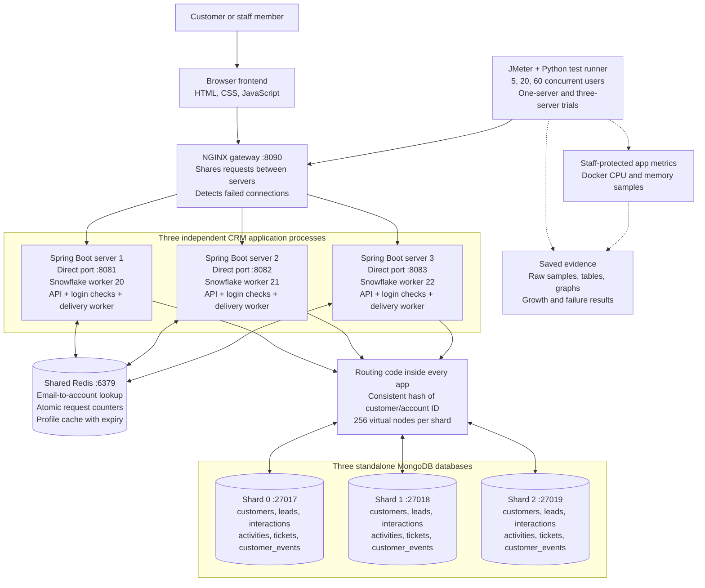
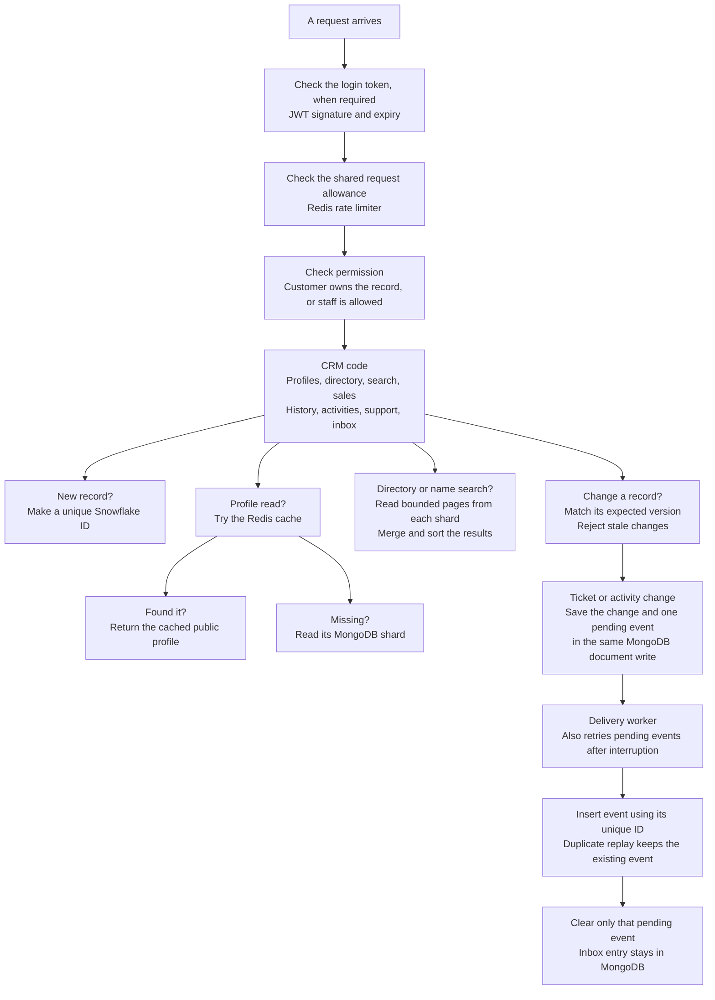

# Relay CRM

**A shared notebook for a business and its customers.**

Imagine a shop with lots of customers. Relay remembers who they are, what they want, what the team promised, and who needs help.

This is a working college project for **UCS3513 — System Design Laboratory**. It has a browser app, several servers, and recorded tests.

## Try it

Open **[http://127.0.0.1:8090](http://127.0.0.1:8090)** when the app is running.

| Who are you? | Email | Password |
| --- | --- | --- |
| Staff member | `ananya.iyer@demo.relay.test` | `demo-password-123` |
| Customer | `aarav.mehta@demo.relay.test` | `demo-password-123` |
| Existing staff account | `raghu.demo@crm.local` | `demo-password-123` |

The first two accounts come from the demo-data tool. Raghu is an existing account in this local setup. These are **practice passwords**, for this local project.

### What can I do?

**As staff:** open Customers, pick a person, and explore their workspace.

- **Profile:** who the customer is.
- **Pipeline:** enquiries and possible sales. An enquiry is a *lead*. A possible deal is an *opportunity*.
- **History:** recorded calls, emails, meetings, and notes.
- **Activities:** jobs the team plans to do next.
- **Support:** questions the customer needs help with.
- **My inbox:** messages addressed to your account. Staff demo messages can open the related customer.

**As a customer:** see your own information, ask for help, reply to support, and read your inbox.

The demo adds **6 staff and 50 customers**, with Indian-style names and linked records. Existing accounts stay in place. [See all demo details](docs/demo-data.md).

## How does it work?

Think of three helpers and three cupboards:

1. The **browser** is the page you use.
2. The **traffic helper**, NGINX, shares requests between three app servers.
3. Each **app server** checks who you are and does the work.
4. **Redis** is a shared quick-access box. It remembers login lookups, request allowances, and recently read profiles.
5. **MongoDB** keeps the saved records in three groups, called *shards*.
6. A **routing rule** chooses an account's home shard. Its business records stay together.

### The detailed architecture map



The routing box is drawn once to keep the picture readable. That code runs inside **each** app server. Redis and the databases are shared by all three app servers.

### What happens inside one server?



Some paths use different steps. Registration and login have their own limits. Opportunities live inside their lead document. Customer inbox events use the outbox; staff briefings are added by the demo-data tool.

### Small words for the big ideas

| Name | Simple meaning |
| --- | --- |
| JWT | A signed, short-lived login pass. Every server can check it. |
| Rate limiter | Stops one account or address from asking too often. |
| Sharding | Splits saved data between several databases. |
| Consistent hashing | Chooses where an account's records belong. It also helps assign sales representatives. |
| Cache | Keeps a quick copy of a recently read profile. |
| Snowflake ID | Gives each new record its own number. Each server uses a different worker number. |
| Version check | Stops an old edit from silently replacing a newer edit. |
| Outbox | Saves a message-to-deliver with the change, so a worker can retry it later. |

## Start it on a new computer

You need **Java 21, Docker Compose, and Git**. The Maven Wrapper downloads the build tool. The first run needs internet access.

Run these commands from this project folder.

**1. Start the databases.**

```sh
docker compose up -d
```

**2. Make the private signing key once.** This keeps an existing key if one is already there.

```sh
mkdir -p .local
umask 077
if [ ! -f .local/jwt.properties ]; then
  printf 'JWT_SECRET=%s\n' "$(openssl rand -base64 32)" > .local/jwt.properties
fi
```

Keep that file private. All three servers read the same key.

**3. Build the app and add practice data.**

```sh
./mvnw -B -ntp package
RUN_DEMO_SEED=true ./mvnw -B -ntp -Dtest=DemoDataSeedTests test
```

**4. Start the three servers and the gateway.**

```sh
docker compose -f compose.yaml -f compose.scale.yaml build app-1
docker compose -f compose.yaml -f compose.scale.yaml up -d app-1 app-2 app-3 gateway
```

Open **http://127.0.0.1:8090** and use a demo login above. A single-server IntelliJ/Maven run uses port 8080; see [authentication setup](docs/authentication.md).

To stop everything while keeping saved data:

```sh
docker compose -f compose.yaml -f compose.scale.yaml stop
```

## Did we test it?

Yes. The latest full backend run had **82 passing tests**, three opt-in tests/tools skipped, and no failures. The data tools and stopped-shard test were also run separately. Small JavaScript/Python checks passed too.

We measured **5, 20, and 60 people asking at once**, using JMeter. We compared one app server with three, grew the test data, and stopped services to see what happened.

Three servers did **not** consistently make requests faster on the shared laptop. The report shows the real results, including errors during failures.

```sh
RUN_INTEGRATION_TESTS=true ./mvnw test
```

Keep the databases running. Stop a native app using worker 0 before running tests. See [test instructions](benchmarks/README.md) for the measured experiments.

## Read more

- [Short project report](docs/short-report.md)
- [Detailed project report](docs/report.md)
- [Measured results and graphs](docs/performance.md)
- [Demo accounts and seed data](docs/demo-data.md)
- [Step-by-step demonstration](docs/demo.md)
- [Requirement completion checklist](docs/requirements-checklist.md)
- [Detailed architecture and component choices](docs/architecture.md)

## What is still limited?

This is a local laboratory prototype. MongoDB shards and Redis do not have backup replicas that automatically take over. Changing the live shard list needs a data-migration plan. Staff demo inbox messages are seeded; future staff assignment alerts are not automatic.

Logging an email or call records it; it does not send an email or make a call. Public deployment also needs stronger account provisioning, secured databases, HTTPS, backups, and operational work. The project has not proved million-user capacity.
