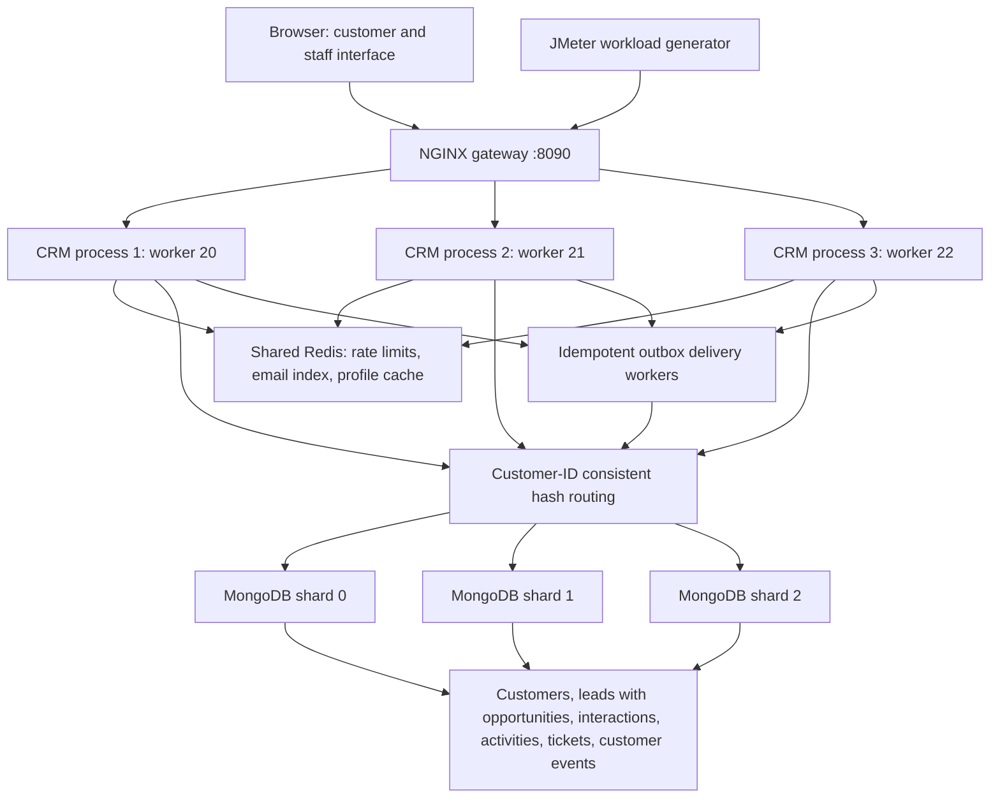

# Relay CRM architecture and component mapping

This laboratory prototype uses Java 21, Spring Boot, MongoDB, Redis, a plain HTML/CSS/JavaScript frontend, Docker Compose, NGINX, and JMeter. No paid services are required for the documented local experiment. The current machine has 16 GB host RAM; Docker is configured with 8 CPUs and about 8 GB memory. Application containers each have a 384 MB maximum JVM heap, a 640 MB container memory limit, and a 2-CPU quota.

The router and outbox workers are code inside each CRM process; they are not additional centralized services. Every replica uses the same shard membership, hash algorithm, JWT signing key, staff allowlist, and Redis instance. Each replica needs a distinct Snowflake worker ID. NGINX uses round-robin request balancing with passive failure detection; consistent hashing is used for data routing and representative assignment, not for routing authenticated HTTP sessions. JWT-based API requests need no sticky sessions.

## Requirement analysis and mapping

| CRM requirement / system challenge | Selected component | Justification and limits |
| --- | --- | --- |
| Registration and login across replicas | Redis key-value email index, JWT, rate limiter | Global email reservation and account lookup; authentication does not depend on per-process sessions. Registration still spans two stores without a distributed transaction. |
| IDs created concurrently on different servers | Snowflake unique ID generator | Timestamp, worker, and sequence bits avoid a single central sequence lock. Clock rollback is rejected, worker IDs must remain unique. IDs are unique; they are not a global gapless incrementing counter. |
| Growing customer/lead/history/ticket data | Application-level sharding | Records route by customer ID; related data stays in the same physical shard. One hot customer remains a single-shard workload. |
| Stable mapping to data shards | Consistent hashing with 256 virtual nodes | Measured key distribution/remapping; requires identical ring membership on every replica. Changing the ring does not migrate existing documents. |
| Representative assignment | Consistent hashing | Deterministic assignment over registered staff, persisted on records. Does not consider employee workload or availability. |
| Fast repeated profile reads | Redis key-value profile cache | Shared cache works across application processes, bounded TTL and version-aware writes. Eventual consistency remains possible after expiry/eviction/failures. |
| Customer search and suggestions | Normalized prefix index and autocomplete | Bounded indexed shard queries with sorted merge. Name-prefix search only, with fan-out cost proportional to shard count. |
| Stale edits, deal qualification, task completion | Atomic conditional MongoDB writes | Expected versions prevent lost updates. One opportunity is embedded in its lead for atomic qualification. |
| Conversation history | Separate indexed interaction/event records | Avoid unbounded arrays in profiles/tickets; bounded cursor pagination. Pages are live reads rather than snapshots. |
| Support-ticket processing | Customer-sharded ticket aggregates and event journal | Owner/staff access, representative assignment, forward status transitions, versioned replies. |
| Durable notifications | MongoDB outbox and customer event inbox | Atomic business-change/event save; retries and duplicate suppression survive worker interruption. Brief delivery delay and per-record write blocking during delivery failure. |
| Concurrent API traffic / overload | Shared atomic Redis fixed-window limiter | All replicas share allowances. Fixed-window boundary bursts and Redis availability are explicit trade-offs. |
| Application server failure and scale-out | Multiple independent CRM processes behind NGINX | Shared data/auth permit another process to serve a request; gateway is itself a single point of failure. Non-idempotent requests are not blindly replayed after an ambiguous upstream write. |

URL shortening and web crawling are omitted: no selected workflow needs shortened links or external company enrichment. Kafka is present in the original dependency set but is not used or required by the current implementation; the durable in-app inbox is implemented with MongoDB. The prototype uses Redis as its key-value store rather than reimplementing a distributed storage engine.

## Request paths

An authenticated profile read passes through the shared quota check and owner/staff check, tries Redis, and falls back to the customer's MongoDB shard. Cached profile responses never contain password hashes. An update atomically matches the profile version, updates the MongoDB record, and attempts to refresh the cache.

Search is staff-only. Each shard scans its normalized name-prefix index, returning at most the page limit. The application merges these bounded results. A missing shard causes the global search to fail rather than return an undisclosed partial result.

Lead, interaction, activity, and ticket URLs contain the customer ID so the request routes directly to one shard. A record lookup also matches customer ID, preventing access through another customer's URL even if both customers share a shard. Ticket and activity updates include a bounded outbox event, delivered to a separate event collection. Notifications belong to their customer recipient.

## Reliability and scaling boundaries

The three databases are independent standalone MongoDB instances, not a native MongoDB sharded cluster or replica sets. They do not provide replica failover. Redis is a single instance with append-only persistence. Loss of Redis causes quota-checked API requests to return 503; liveness remains available. A failed data shard makes that shard's uncached records unavailable; data routed to other shards remains accessible. Global search/queues need every shard.

Application replicas can be added without moving customer data. Adding/removing **data shards** requires a migration design before changing the live ring. Existing tests quantify ring remapping only; no implementation automatically migrates or replicates stored records. This limitation must be stated during the demonstration.

All documented ports bind to loopback. Databases have no authentication in this lab configuration. Public deployment requires network isolation, authenticated/encrypted data stores, HTTPS, backup/restore, secret management, and operational monitoring. This project demonstrates implemented scale-out behavior and measured local workloads; it does not establish million-user capacity.

Staff roles rely on a configured email allowlist without email verification. Staff accounts must be provisioned by a trusted operator before public registration is exposed; allowing an untrusted person to claim an unregistered allowlisted email would grant staff scope. This local prototype is not an externally exposed account-provisioning system.

Official references: [MongoDB single-document atomicity](https://www.mongodb.com/docs/manual/core/write-operations-atomicity/), [NGINX upstream balancing and failure parameters](https://nginx.org/en/docs/http/ngx_http_upstream_module.html), [JMeter CLI testing](https://jmeter.apache.org/usermanual/get-started.html).
