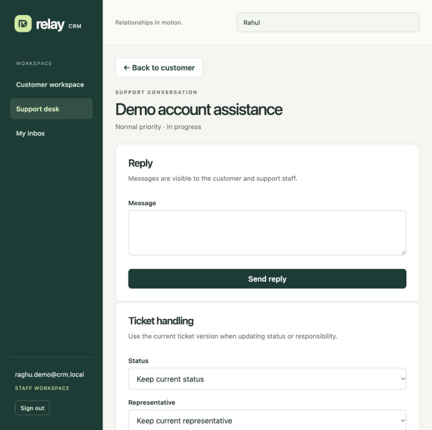
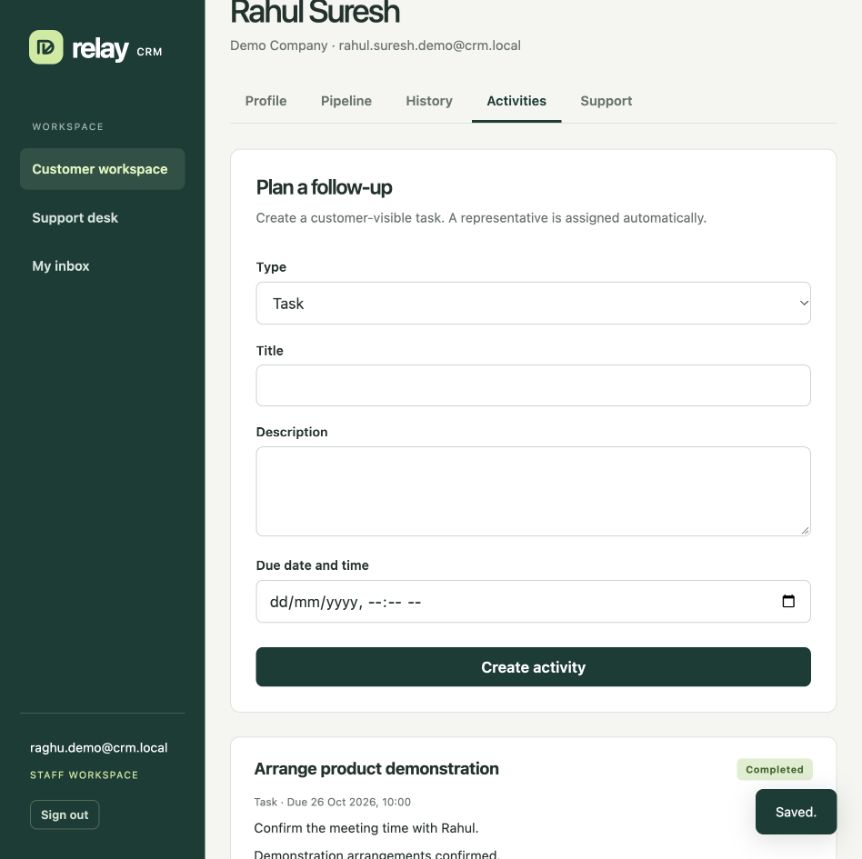

# End-to-end demonstration

## Start

The measured multi-process setup uses:

```sh
docker compose -f compose.yaml -f compose.scale.yaml up -d app-1 app-2 app-3 gateway
```

Build the JAR and image first on a fresh clone as described in [benchmark instructions](../benchmarks/README.md). Open `http://127.0.0.1:8090`. A native development run instead uses `./mvnw spring-boot:run` and port 8080.

Existing local demo accounts:

| Role | Email | Password |
| --- | --- | --- |
| Staff | raghu.demo@crm.local | demo-password-123 |
| Customer | rahul.suresh.demo@crm.local | demo-password-123 |

These are synthetic local demonstration credentials, not deployment secrets. They are not automatically seeded on a fresh clone. Create the accounts through registration and configure `CRM_STAFF_EMAILS` for the staff email. Do not reuse demo passwords in a public deployment.

## Functional walkthrough

1. Register a new ordinary customer or sign in as the demo customer. Change company/phone under Profile and save. The customer portal has no staff pipeline or global search controls.
2. Open Support and create a ticket with a subject, priority, and message. The conversation shows the creation event. Open My inbox and acknowledge its notification.
3. Sign out and sign in as staff. Search for `Rahul` and select the customer. Staff can read this profile but cannot edit someone else's profile through the API.
4. Open Pipeline, create a lead, and qualify it with an amount/currency. Advance the opportunity to Proposal/Negotiation/Won as required. Current versions are sent automatically.
5. Open History and record a call/email/meeting/note. Open Activities, create a future task, then use its inline status/outcome form to complete it. Both are visible to that customer.
6. Open Support desk, find the customer's ticket, reply, and move it to In progress or Resolved. Assignment can be changed to another eligible registered staff member. The local default has one staff member.
7. Sign in as the customer again. The reply/status/task updates appear in My inbox; the support conversation shows all public messages. Customer accounts cannot update ticket status or staff-managed activities.

The browser checks on 25 October 2026 exercised customer registration/sign-in, own inbox acknowledgement, staff search, lead creation/qualification/progression, interaction creation, activity creation/completion, and staff support replies/status changes. An unsupported native prompt found during testing was replaced by the current inline activity form. The saved screenshots show actual persisted demo records:





## Demonstrate system behavior

- Show three independent `app-1/2/3` containers in `docker compose -f compose.yaml -f compose.scale.yaml ps`.
- Make authenticated requests through port 8090 and inspect `X-CRM-Upstream` in Postman. Responses should come from different app container addresses. The same token works across all replicas.
- Inspect the profile's `shardId`, or the interaction/activity `X-Data-Shard` header, and locate the customer/related records in the corresponding Compass database. Data is colocated by customer ID.
- Show the version conflict with two requests carrying the same old version; the second returns 409. Show 401 without a token and 403 with the wrong customer's token.
- Show the fixed-window limiter under its default API quota of 120 per customer per 60 seconds. Rejections return 429 and Retry-After. Do not confuse default-limit rejection with the separately configured capacity trials.
- Stop `app-2`, issue more requests through the gateway, then start it again. Passive NGINX failure detection routes safe requests to remaining replicas. The measured fault trial and response distribution are retained in the report.
- Use the existing benchmark evidence for shard/Redis outages, or rerun the documented experiments. Do not change live shard membership to simulate a failed server; that would reroute keys without migrating documents.

## Evidence for the submission

Use [architecture and mapping](architecture.md), [support/outbox design](support-notifications.md), [measured performance](performance.md), and [project report](report.md). The report includes measured tables and graphs, baseline limitations, workload growth, failure/recovery behavior, and unresolved operational risks. It must not be presented as evidence of database replication or million-user operation.
