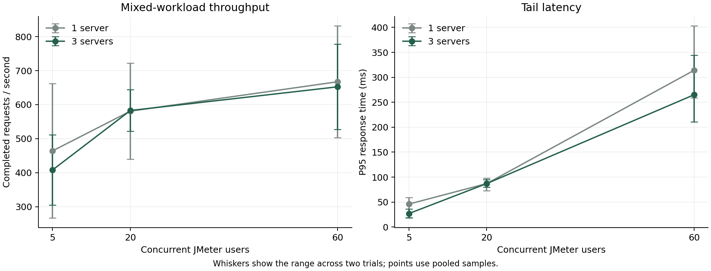

# Measured performance and failure evaluation

Measured on 25 October 2026 on one Apple Silicon laptop. These results establish behavior for this local configuration; they are not a forecast for production hardware or millions of users.

## Method

- JMeter 5.6.3 in CLI mode; 5, 20, and 60 concurrent threads; two trials per one-server/three-server configuration.
- Each trial has a 2-second ramp and a 7-second excluded warm-up, with about 20 seconds of retained samples. The report uses actual sample spans rather than the requested duration as its throughput denominator.
- Each loop sends equal numbers of profile reads, indexed staff searches, autocomplete requests, history reads, ticket-list reads, and interaction writes: about 83% reads and 17% writes. Assertions validate response content, ownership IDs, search prefixes, and expected creation status.
- Both configurations use the same backend, MongoDB shards, Redis, and an NGINX gateway. Baseline has one active JVM; scaled has three independent JVM/container processes with worker IDs 20/21/22. This isolates application process count, not a comparison to an entirely unsharded CRM.
- Each app has a 384 MiB maximum Java heap, 640 MiB container memory limit, and 2-CPU quota. Docker has 8 CPUs and about 8 GB memory. JMeter and containers share the same laptop.
- Capacity trials raise the authenticated API limit to 1,000,000 requests/customer/window, preventing throttling from dominating capacity. Default runtime limits are 120. Limiter correctness/rejection is evaluated separately.
- The fixture tool initially seeds 200 synthetic customers and 10 historical interactions each; a few existing demo accounts remain. Interaction-writing workloads add records during trials. The growth case expands to 3,000 synthetic customers and their initial histories. This is a growth scenario, not an isolated causal experiment on customer count alone.
- Fixed execution order is baseline before scaled; JVM warm-up, cache state, accumulating history, and shared-machine contention can affect comparisons. Two short trials do not establish statistical significance. Tests are closed-loop without think time and do not correct for coordinated omission.
- Profile cache is enabled in both server-count configurations. Prior indexed-search versus forced-collection-scan tests provide a separate algorithm baseline.
- Raw result files contain synthetic IDs/URLs and timing/status data. Authorization headers, bodies, signing keys, and tokens are not retained in tracked results. Authentication setup/token issuance is outside the timed request mix.

## Overall results

Means/P95 and success rates below are calculated from pooled retained raw samples. Throughput is total requests divided by summed measured trial spans.

| Active app servers | Users | Trials | Requests | Mean ms | P95 ms | Requests/s | Success % | Error % | Mean app CPU % | Sum of app peak memory MiB |
| --- | --- | --- | --- | --- | --- | --- | --- | --- | --- | --- |
| 1 | 5 | 2 | 18516 | 10.29 | 46 | 464.07 | 100.000 | 0.000 | 194.6 | 459.1 |
| 1 | 20 | 2 | 23148 | 33.87 | 87 | 580.89 | 100.000 | 0.000 | 206.2 | 461.1 |
| 1 | 60 | 2 | 26716 | 88.58 | 314 | 667.30 | 100.000 | 0.000 | 207.0 | 467.4 |
| 3 | 5 | 2 | 16237 | 11.67 | 27 | 408.01 | 100.000 | 0.000 | 336.8 | 1360.3 |
| 3 | 20 | 2 | 23285 | 33.66 | 87 | 582.75 | 100.000 | 0.000 | 420.8 | 1369.7 |
| 3 | 60 | 2 | 26278 | 90.39 | 265 | 652.42 | 100.000 | 0.000 | 447.5 | 1368.6 |

Trial-to-trial variation is substantial. The graph whiskers show the two-trial ranges; the data does not support a statistical claim of scaling efficiency.

Docker CPU 100% represents roughly one occupied CPU core. CPU is the sum of per-app sample means in the measurement window. Memory is the sum of each app’s observed peak container memory; these peaks need not be simultaneous. Resource samples are coarse Docker snapshots, not continuous hardware profiling. Database/Redis/gateway resource snapshots are retained in each run JSON.

## Endpoint and component measurements

The following response times use the pooled three-server, 60-user samples. They include gateway, authentication, quota checking, serialization, and database/cache work.

| Endpoint | Requests | Mean ms | P95 ms | Errors |
| --- | --- | --- | --- | --- |
| autocomplete | 4378 | 131.39 | 357 | 0 |
| history | 4380 | 68.41 | 186 | 0 |
| interaction_write | 4384 | 72.13 | 194 | 0 |
| profile | 4384 | 66.84 | 187 | 0 |
| search | 4376 | 133.92 | 378 | 0 |
| tickets | 4376 | 69.71 | 193 | 0 |

Internal component timer means use before/after Micrometer counter differences across all active app processes. Unlike the HTTP table, these timer intervals include the warm-up. Cache lookup includes Redis access and JSON decoding; it is not a measurement of Redis server execution time alone.

| Component timer, scaled 60 users | Calls | Mean ms |
| --- | --- | --- |
| crm.customer_cache.lookup | 5723 | 13.261 |
| crm.rate_limit.lookup | 34001 | 21.396 |
| crm.customer_search.lookup | 11384 | 79.372 |
| crm.customer_autocomplete.lookup | 5678 | 79.170 |

Additional component checks from the regression suite:

- Snowflake: 400,000 IDs, 0 collisions; last recorded in-process generation rate 2,501,532 IDs/s. This isolated loop is not API registration throughput.
- Shared Redis limiter: 100 requests, allowance 25, exactly 25 admitted and 75 rejected (75% rejection), no overshoot across 20 threads and two limiter objects.
- Hash-ring routing: 100,000 keys distributed 33.09%, 33.81%, 33.10%; adding a fourth node remapped 27.50%, versus 75.01% for the tested modulo baseline. Removing one ring node remapped 33.10%. No stored data was migrated.
- Indexed name search: 12 documents examined versus 803 for the forced collection-scan baseline in the latest full suite (600 temporary search fixtures plus existing local records). Autocomplete top-five accuracy was 5/5 expected results for its controlled fixture test.
- Concurrent qualification, activity completion, and support reply tests each used 32 competing updates at one version: one succeeded, 31 conflicted.

## Data and request distribution

Synthetic-customer distribution after expansion: shard-0: 987, shard-1: 1009, shard-2: 1004.

Gateway upstream counts for each measured scaled trial are retained below. Container addresses identify the actual responding JVM; they are local experiment identifiers, not public endpoints.

| Trial | Responses by upstream address |
| --- | --- |
| scaled-c5-r1 | 172.18.0.6:8080: 2018, 172.18.0.8:8080: 2018, 172.18.0.9:8080: 2017 |
| scaled-c20-r1 | 172.18.0.6:8080: 3476, 172.18.0.9:8080: 3477, 172.18.0.8:8080: 3476 |
| scaled-c60-r1 | 172.18.0.6:8080: 3548, 172.18.0.9:8080: 3548, 172.18.0.8:8080: 3548 |
| scaled-c5-r2 | 172.18.0.8:8080: 3395, 172.18.0.9:8080: 3395, 172.18.0.6:8080: 3394 |
| scaled-c20-r2 | 172.18.0.6:8080: 4286, 172.18.0.9:8080: 4285, 172.18.0.8:8080: 4285 |
| scaled-c60-r2 | 172.18.0.8:8080: 5211, 172.18.0.6:8080: 5211, 172.18.0.9:8080: 5212 |

## Growth and failures

| Scenario | Requests / observation | Mean ms | P95 ms | Requests/s | Success % |
| --- | --- | --- | --- | --- |
| 3,000-customer growth, 3 servers, 20 users | 14798 | 26.47 | 70 | 740.94 | 100.000 |
| Stop app-2 during a 20-user workload | 15451 | 25.11 | 66 | 777.21 | 99.994 |

App-outage HTTP statuses: {"200": 12874, "201": 2576, "502": 1}. Upstream distribution: {"172.18.0.9:8080": 6786, "172.18.0.8:8080": 1871, "172.18.0.6:8080": 6784, "172.18.0.8:8080, 172.18.0.6:8080": 5, "172.18.0.8:8080, 172.18.0.9:8080": 5}. The stop was triggered during the run; exact fault timestamps are in its JSON. NGINX can retry safe connection failures; a write already sent upstream can still have an ambiguous outcome and must not be blindly replayed.

With MongoDB shard 2 stopped, 60 uncached customer-history probes returned {"200": 44, "503": 16}. Global staff search returned 503. Recovery search returned 200 after 3.197 seconds from starting recovery probes. Other-shard successes demonstrate isolation; affected-shard 503 responses demonstrate the absence of replica failover.

With Redis stopped, an authenticated API request returned 503 in 1051.099 ms; liveness returned 200. Recovery API status was 200 after 0.824 seconds of probing. The quota path intentionally fails closed.

Worker-recovery tests separately verified durable outbox delivery after interruption and duplicate replay without resetting read acknowledgements. All stopped services are restored by the runner; inspect Compose health before demonstrating the system.

## Interpretation and limits

The measurements show no consistent throughput gain from three processes in this setup. At 60 users, pooled throughput is about 667 requests/s on one app and 652 on three, while P95 improves from 314 ms to 265 ms. Aggregate app CPU and memory consumption increase. This is evidence of load distribution and application redundancy, not linear throughput scaling.

Baseline app CPU samples are close to its two-CPU quota, and search/autocomplete are the slowest measured endpoints. CPU pressure and three-shard search fan-out are plausible contributors. More app servers also share Redis, data shards, CPU budget, and the client machine. These are evidence-informed hypotheses, not profiler-confirmed root causes.

The experiment demonstrates application process scaling, load distribution, controlled data growth, dependency failure behavior, and recovery. It does not implement database replication or shard migration, measure independent-machine/cloud capacity, establish a maximum sustainable production throughput, or provide a security penetration test. There is no basis here to claim fully fault-tolerant or million-user operation.

## Reproduction and evidence

See [benchmark instructions](../benchmarks/README.md). Numeric comparison: [CSV](../benchmarks/results/comparison.csv), [JSON](../benchmarks/results/comparison.json). Full run summaries and compressed JMeter samples are in [benchmarks/results](../benchmarks/results/). The generated JMeter plan is [crm.jmx](../benchmarks/crm.jmx).
